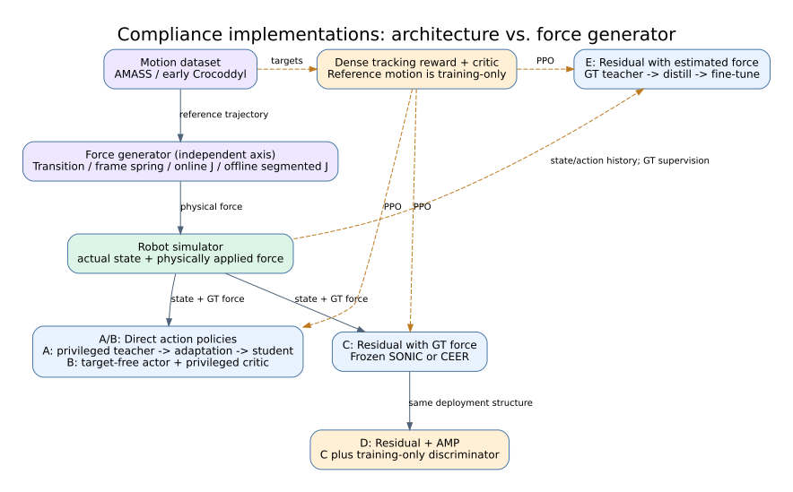
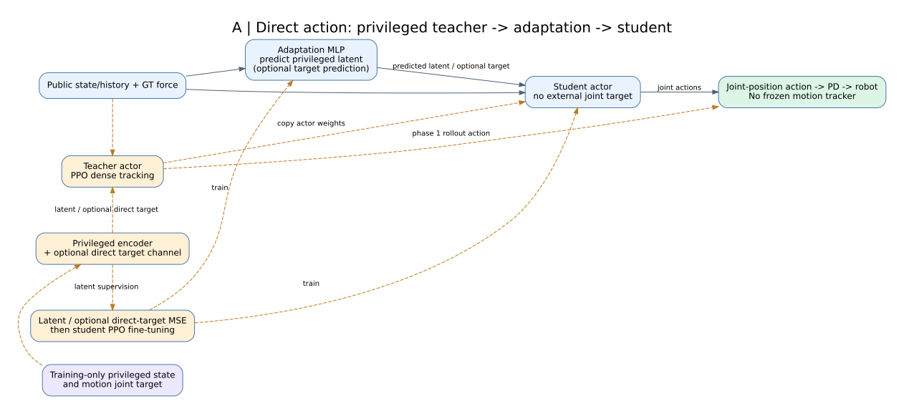
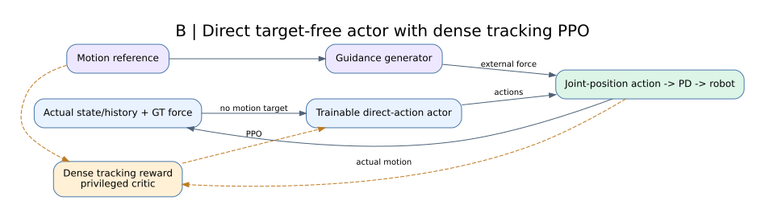
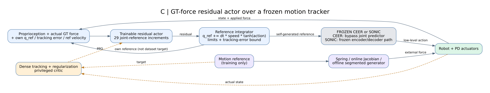
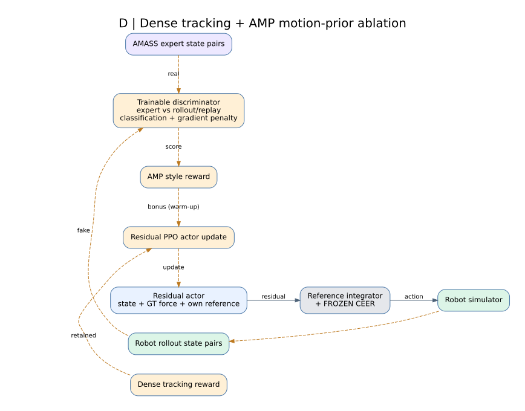
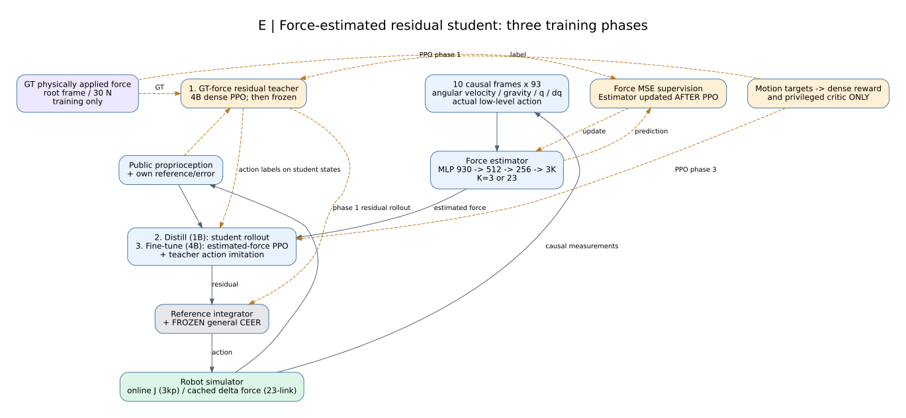

# Compliance 训练架构梳理

核对日期：2026-10-29。依据当前配置和实现；不是把历史所有 checkpoint 当成同一版本，也不据此重新评价性能。

**按训练结构可分 5 类；按控制主干则只有两类：直接关节动作、frozen tracker 上的 joint-reference residual。**施力点数量和外力生成方式是独立维度。AMP 是奖励扩展，force estimator 是输入/训练阶段扩展，并非全新的底层控制器。

图由 Graphviz DOT 关系代码排版，非生成式图片。蓝色为执行模块，灰色为冻结模块，橙色为训练模块，紫色为参考/标签。实线为数据/控制流，橙色虚线为训练专用输入或更新关系；虚线不表示对物理仿真做可微反传。图中 `J` 指 Jacobian。

## 0. 总览



## 1. 五类结构

| 类别 | 对应实验/配置 | Actor 执行时看到什么 | 输出和训练方式 |
|---|---|---|---|
| A 直接动作 teacher–student | 早期 EE、locomotion；`passive_compliance`、`passive_spring_direct` | 自身状态/history、GT 外力、预测的特权 latent；部分配置另预测 direct target | teacher 的特权编码/直接目标在 student 中由 adaptation MLP 替代；actor 权重复制，latent/target MSE，student PPO 微调；直接关节位置动作 |
| B 直接动作 PPO | 初期 general whole-body；`passive_whole_body` | 公开本体状态＋GT 外力 | actor 不直接读 motion target；dense tracking reward、训练用 critic；直接关节位置动作，无冻结 tracker |
| C GT-force residual PPO | SONIC residual；CEER spring9/18、Jacobian9、segmented18/root3、3kp online、3kp spring | 本体状态、实际外力 GT、自身生成的参考及跟踪误差 | residual 更新自身 q_ref，输入 frozen tracker；训练 residual actor/critic |
| D Residual + AMP | `ceer_residual_amp` + segmented force | 与 C 相同 | dense reward 保留，再加 discriminator 的 motion-prior reward；判别器仅训练时使用 |
| E Force-estimated residual teacher–student | 23-link dense 三阶段、最新 3kp online estimator | 本体状态、自身参考、估计力；estimator 看因果历史 | GT teacher PPO → student rollout 蒸馏 → estimated-force PPO 微调；frozen CEER |

### A：直接动作 teacher–student



早期 adaptation 估计器主要预测 teacher 的**特权 latent**，某些 `direct_priv_keys` 配置还预测 joint target；不能把它称为当前 E 类的“物理外力估计器”。执行时没有外部 motion target，但原来的 GT force 仍是公开输入。相关实现：`active_adaptation/learning/hierarchical/root_student_ppo.py`、`cfg/algo/passive_compliance.yaml`、`cfg/algo/passive_spring_direct.yaml`。`phase=train/adapt/finetune` 三种更新不同：teacher PPO+adaptation、adaptation-only、student PPO；不是 E 类的 action-DAgger 流程。

### B：直接动作 PPO



“没有 target 输入”不等于“没有 tracking reward”：reference 用于算奖励/critic，不作为 actor 的执行指令。相关配置：`cfg/algo/passive_whole_body.yaml`、`cfg/task/G1/G1_passive_whole_body.yaml`。

### C：GT 外力 residual



参考更新是设计的一部分：`q_ref += dt * reference_speed * tanh(action)`，再应用关节限制与实际跟踪误差约束。residual 加在**参考输入**上，不是直接加到执行器 torque 或底层输出 action 上。CEER 绕过 joint predictor，使用 residual 更新后的关节参考；SONIC 使用自己的冻结 encoder/decoder 路径。两者的底层接口并不相同。

相关实现：`active_adaptation/envs/mdp/ceer_residual.py`、`sonic_residual.py`，`active_adaptation/learning/hierarchical/sonic_residual_ppo.py`。最近的 **3kp online 和 3kp spring 均属于 C，均直接读取实际外力 GT**。

### D：AMP 奖励扩展



真实 motion state pair 与机器人 rollout/replay pair 训练判别器，style reward 加到 dense reward。没有替换掉 dense tracking，也不是完整复现 BFMZero。执行结构和 C 相同，部署不需要判别器。

相关实现：`active_adaptation/learning/hierarchical/compliance_amp_ppo.py`、`cfg/algo/ceer_residual_amp.yaml`。

### E：外力估计三阶段



1. Teacher：本体/自身参考＋GT force，dense PPO（4B frames）。
2. 蒸馏：student 自己 rollout；冻结 teacher 在同一实际状态上用 GT force 提供 action 标签；actor 学 residual，estimator 学实际外力 MSE（1B）。
3. 微调：student 用估计外力做 PPO，保留 teacher imitation；本轮 PPO 后才更新 estimator，避免改变 rollout 的行为分布输入（4B）。

Estimator 使用 CEER 风格 MLP：10×93=930 维历史 → 512 → 256 → 3K，K=3 或23。输入为 root 角速度、重力方向、关节位置/速度、实际 low-level action；不读取 motion reference、接触力或 GT force。输出 root-frame 力，按 30N 缩放。GT 标签是 slew 后**实际施加的力**。阶段2/3的 VecNorm冻结；底层 CEER 全程冻结。该 estimator 是新增网络，不是声称使用预训练 CEER2 外力估计权重，也不同于 frozen CEER 内部的状态 estimator。

相关实现：`active_adaptation/learning/hierarchical/dense_force_ppo.py`；命令 `dense_link_compliance.py` 与 `online_estimated_compliance.py`。

## 2. 与训练架构独立的“施力生成”维度

| 生成方式 | 主要依据 | 在线依赖实际机器人状态？ | 对应版本 |
|---|---|---|---|
| Transition anchor | 从参考轨迹取间隔目标，拟合/构造引导 | 执行弹簧时依赖实际位置 | 早期 EE、locomotion；不同历史版本参考推进方式有差异 |
| 帧间/多点弹簧及分配 | 下一帧 anchor、实际点位置/速度；部分版本另有合力/yaw 分配 | 是 | 早期 frame-spring、whole-body spring9/18 |
| **3kp direct spring** | 每点 `80*(p_ref_next-p_actual)` | 是 | C；三个点持续连接，无 Jacobian 分配 |
| **在线 Jacobian** | joint delta＋joint tracking error；root translation/yaw error；当前 J 分配力 | 是 | C 的9点、3点；E 的最新3点 estimator |
| **离线 segmented Jacobian** | 参考轨迹的名义引导量，联合分段/选点/力序列优化及质量筛选 | 预计算不依赖实际 rollout 状态 | C 的18点/3点；D 的 AMP |
| **23-link dense cached force** | `K*(p_ref_next-p_ref_current)`；预计算固定 K 力缓存 | 名义力不依赖实际位置误差 | E 的23-link 三阶段 |

注意：3kp spring 是“目标下一帧－实际当前状态”，23-link dense 是“参考下一帧－参考当前帧”，二者不同。两者都叫 spring 不能据此推断是否有 force estimator。

9/18 是候选施力点个数，旧稀疏方法每次通常只施加1–3个力；3kp direct spring 三点持续连接；23-link dense 可同时施加23个力。

## 3. 当前几版归属

- 3kp online GT：C＋在线 Jacobian，9维 GT 力。
- 3kp spring GT：C＋直接下一帧三点弹簧，9维 GT 力。
- 9点 no-EE reward：C＋在线 Jacobian；只关闭独立 `ee_tracking` 项，不是新训练架构，joint/keypoint仍间接约束手臂。
- 3kp online estimator：E＋在线 Jacobian，student 使用9维估计力，teacher使用GT；保留原3kp online的EE奖励。
- 23-link dense estimator：E＋离线参考差分密集力，student 使用69维估计力。
- Segmented AMP：D＋离线分段力；actor仍使用GT force。

在 MuJoCo 人工交互部署中，训练参考和自动施力生成器都不运行。C/D 读取实际鼠标施力；E 的 student 应通过历史估计力。actor看到的 q_ref 是自身 residual 累积出的参考，不是下一帧外部目标。

## 4. 编辑与导出

每幅图都有 `.dot`（关系源码）、`.svg`（矢量）、`.pdf`（矢量）、`.png`。`render.py` 包含节点和边的完整定义。

安装 Graphviz 后：

```bash
python docs/compliance_architectures/render.py
# 或只修改、重绘一张
 dot -Tsvg docs/compliance_architectures/03_residual_gt.dot -o residual.svg
```

此工作区使用局部解包的 Graphviz，不改变训练环境；工具位于 `artifacts/compliance_architectures_20261029/tooling/root/`。
